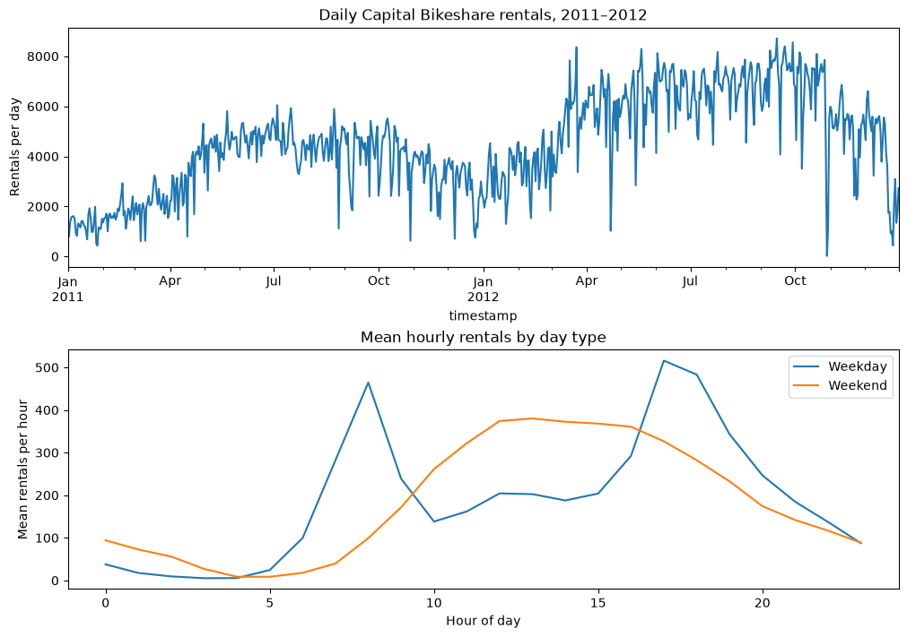
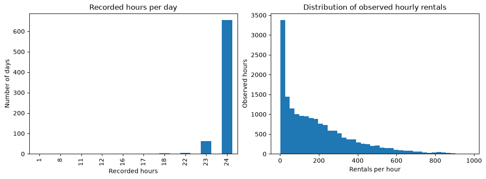
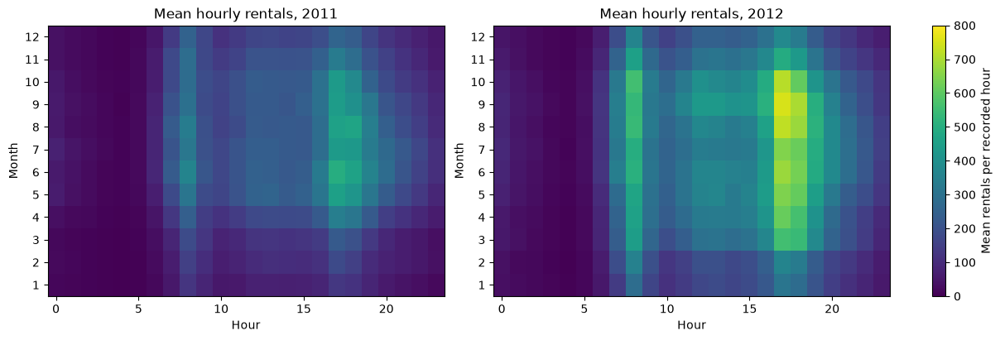
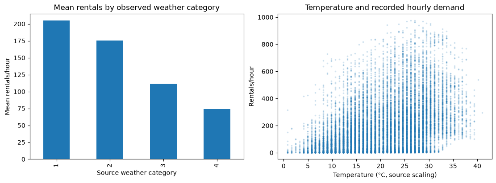
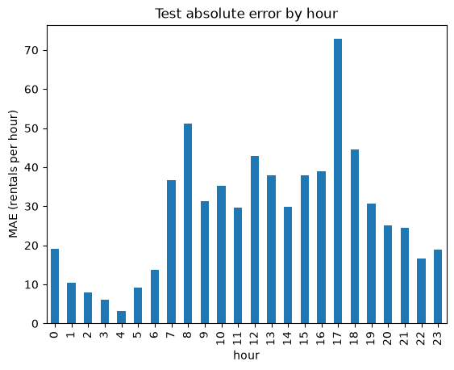
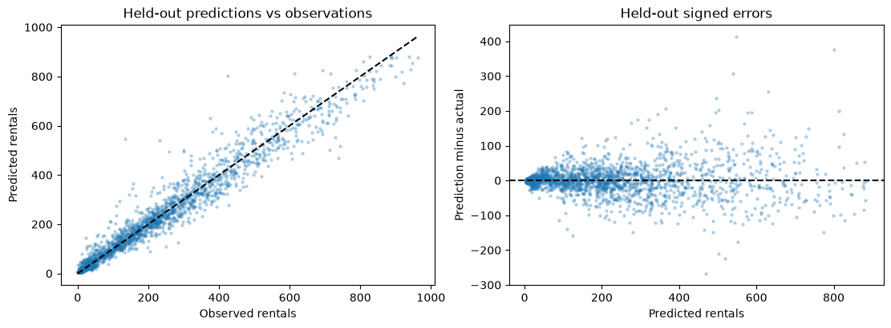

# BikePulse: real hourly rental demand

## tl;dr
Analyzed 17,379 real Capital Bikeshare hourly observations from 2011–2012. Gradient boosting achieved test MAE of 28.3 rentals/hour versus 69.6 for the weekly baseline, a 59.3% reduction across 2,098 eligible October–December 2012 hours. This is repeated one-hour-ahead historical evaluation with observed demand lags; it does not establish live deployment accuracy.

## Context & Methods
Forecast one hour ahead using calendar information and exact clock-hour demand lags. Train before July 2012, select on July–September, and test on October–December.

### Key Assumptions
The previous observed hour is available at each forecast origin. Missing lag observations are excluded. No future observed weather or rental components enter the model. This is historical replay, not a live forecast.

Source: [UCI Bike Sharing](https://archive.ics.uci.edu/dataset/275/bike+sharing+dataset), DOI 10.24432/C5W894. Fanaee-T & Gama; CC BY 4.0.


```python
from pathlib import Path
import sys
root = Path.cwd() if (Path.cwd() / 'bikepulse').exists() else Path.cwd().parent
sys.path.insert(0, str(root))
import pandas as pd
import matplotlib.pyplot as plt
from bikepulse.data import load_data
from bikepulse.model import prepare, train
frame = load_data()
```

    mkdir -p failed for path /home/agent/.config/matplotlib: [Errno 30] Read-only file system: '/home/agent/.config/matplotlib'


    Matplotlib created a temporary cache directory at /tmp/matplotlib-2poy4roi because there was an issue with the default path (/home/agent/.config/matplotlib); it is highly recommended to set the MPLCONFIGDIR environment variable to a writable directory, in particular to speed up the import of Matplotlib and to better support multiprocessing.


## Data
### Validate observations and missing hours


```python
expected = pd.date_range(frame.index.min(), frame.index.max(), freq='h')
print({'observed_hours': len(frame), 'missing_hours': len(expected.difference(frame.index)), 'duplicate_hours': int(frame.index.duplicated().sum())})
display(frame[['cnt', 'holiday', 'weathersit']].describe())
display(frame.isna().sum().to_frame('null_count'))
x, y = prepare(frame)
print('Rows retained after lag requirements:', len(x))
```

    {'observed_hours': 17379, 'missing_hours': 165, 'duplicate_hours': 0}


<div>
<style scoped>
    .dataframe tbody tr th:only-of-type {
        vertical-align: middle;
    }

    .dataframe tbody tr th {
        vertical-align: top;
    }

    .dataframe thead th {
        text-align: right;
    }
</style>
<table border="1" class="dataframe">
  <thead>
    <tr style="text-align: right;">
      <th></th>
      <th>cnt</th>
      <th>holiday</th>
      <th>weathersit</th>
    </tr>
  </thead>
  <tbody>
    <tr>
      <th>count</th>
      <td>17379.000000</td>
      <td>17379.000000</td>
      <td>17379.000000</td>
    </tr>
    <tr>
      <th>mean</th>
      <td>189.463088</td>
      <td>0.028770</td>
      <td>1.425283</td>
    </tr>
    <tr>
      <th>std</th>
      <td>181.387599</td>
      <td>0.167165</td>
      <td>0.639357</td>
    </tr>
    <tr>
      <th>min</th>
      <td>1.000000</td>
      <td>0.000000</td>
      <td>1.000000</td>
    </tr>
    <tr>
      <th>25%</th>
      <td>40.000000</td>
      <td>0.000000</td>
      <td>1.000000</td>
    </tr>
    <tr>
      <th>50%</th>
      <td>142.000000</td>
      <td>0.000000</td>
      <td>1.000000</td>
    </tr>
    <tr>
      <th>75%</th>
      <td>281.000000</td>
      <td>0.000000</td>
      <td>2.000000</td>
    </tr>
    <tr>
      <th>max</th>
      <td>977.000000</td>
      <td>1.000000</td>
      <td>4.000000</td>
    </tr>
  </tbody>
</table>
</div>


<div>
<style scoped>
    .dataframe tbody tr th:only-of-type {
        vertical-align: middle;
    }

    .dataframe tbody tr th {
        vertical-align: top;
    }

    .dataframe thead th {
        text-align: right;
    }
</style>
<table border="1" class="dataframe">
  <thead>
    <tr style="text-align: right;">
      <th></th>
      <th>null_count</th>
    </tr>
  </thead>
  <tbody>
    <tr>
      <th>instant</th>
      <td>0</td>
    </tr>
    <tr>
      <th>dteday</th>
      <td>0</td>
    </tr>
    <tr>
      <th>season</th>
      <td>0</td>
    </tr>
    <tr>
      <th>yr</th>
      <td>0</td>
    </tr>
    <tr>
      <th>mnth</th>
      <td>0</td>
    </tr>
    <tr>
      <th>hr</th>
      <td>0</td>
    </tr>
    <tr>
      <th>holiday</th>
      <td>0</td>
    </tr>
    <tr>
      <th>weekday</th>
      <td>0</td>
    </tr>
    <tr>
      <th>workingday</th>
      <td>0</td>
    </tr>
    <tr>
      <th>weathersit</th>
      <td>0</td>
    </tr>
    <tr>
      <th>temp</th>
      <td>0</td>
    </tr>
    <tr>
      <th>atemp</th>
      <td>0</td>
    </tr>
    <tr>
      <th>hum</th>
      <td>0</td>
    </tr>
    <tr>
      <th>windspeed</th>
      <td>0</td>
    </tr>
    <tr>
      <th>casual</th>
      <td>0</td>
    </tr>
    <tr>
      <th>registered</th>
      <td>0</td>
    </tr>
    <tr>
      <th>cnt</th>
      <td>0</td>
    </tr>
  </tbody>
</table>
</div>


    Rows retained after lag requirements: 16897


## Results
### Daily demand and hourly commuting patterns


```python
fig, axes = plt.subplots(2, 1, figsize=(10, 7), constrained_layout=True)
frame['cnt'].resample('D').sum().plot(ax=axes[0], title='Daily Capital Bikeshare rentals, 2011–2012')
axes[0].set_ylabel('Rentals per day')
profile = frame.assign(weekend=frame.index.dayofweek >= 5).groupby(['hr', 'weekend'])['cnt'].mean().unstack()
profile.columns = ['Weekday', 'Weekend']
profile.plot(ax=axes[1], title='Mean hourly rentals by day type')
axes[1].set_xlabel('Hour of day')
axes[1].set_ylabel('Mean rentals per hour')
plt.show()
```





### Hourly coverage and demand distributions
Absent hours are not assumed to have zero rentals. Compare coverage and distribution before interpreting unusual daily totals.


```python
coverage = frame['cnt'].resample('D').count()
fig, axes = plt.subplots(1, 2, figsize=(11, 4), constrained_layout=True)
coverage.value_counts().sort_index().plot.bar(ax=axes[0], title='Recorded hours per day')
axes[0].set_xlabel('Recorded hours'); axes[0].set_ylabel('Number of days')
frame['cnt'].plot.hist(bins=40, ax=axes[1], title='Distribution of observed hourly rentals')
axes[1].set_xlabel('Rentals per hour'); axes[1].set_ylabel('Observed hours')
plt.show()
```





### Month-by-hour patterns
Compare monthly hourly averages separately by year. These descriptive heatmaps use all historical data and do not select model settings.


```python
fig, axes = plt.subplots(1, 2, figsize=(12, 4), constrained_layout=True)
for year, ax in zip([2011, 2012], axes):
    subset = frame.loc[frame.index.year == year]
    matrix = subset.groupby(['mnth', 'hr'])['cnt'].mean().unstack().reindex(index=range(1,13), columns=range(24))
    image = ax.imshow(matrix, aspect='auto', origin='lower', vmin=0, vmax=800, cmap='viridis')
    ax.set_title(f'Mean hourly rentals, {year}')
    ax.set_xlabel('Hour'); ax.set_ylabel('Month')
    ax.set_yticks(range(12), range(1,13))
fig.colorbar(image, ax=axes, label='Mean rentals per recorded hour')
plt.show()
```





### Weather associations
These are observational associations, not causal effects. Weather categories may differ in calendar composition, and sparse categories are less reliable. Future observed weather is excluded from forecasting inputs.


```python
weather = frame.groupby('weathersit')['cnt'].agg(['count','mean','median'])
display(weather)
fig, axes = plt.subplots(1, 2, figsize=(11,4), constrained_layout=True)
weather['mean'].plot.bar(ax=axes[0], title='Mean rentals by observed weather category')
axes[0].set_xlabel('Source weather category'); axes[0].set_ylabel('Mean rentals/hour')
axes[1].scatter(frame['temp'] * 41, frame['cnt'], s=3, alpha=.15)
axes[1].set_title('Temperature and recorded hourly demand')
axes[1].set_xlabel('Temperature (°C, source scaling)'); axes[1].set_ylabel('Rentals/hour')
plt.show()
```


<div>
<style scoped>
    .dataframe tbody tr th:only-of-type {
        vertical-align: middle;
    }

    .dataframe tbody tr th {
        vertical-align: top;
    }

    .dataframe thead th {
        text-align: right;
    }
</style>
<table border="1" class="dataframe">
  <thead>
    <tr style="text-align: right;">
      <th></th>
      <th>count</th>
      <th>mean</th>
      <th>median</th>
    </tr>
    <tr>
      <th>weathersit</th>
      <th></th>
      <th></th>
      <th></th>
    </tr>
  </thead>
  <tbody>
    <tr>
      <th>1</th>
      <td>11413</td>
      <td>204.869272</td>
      <td>159.0</td>
    </tr>
    <tr>
      <th>2</th>
      <td>4544</td>
      <td>175.165493</td>
      <td>133.0</td>
    </tr>
    <tr>
      <th>3</th>
      <td>1419</td>
      <td>111.579281</td>
      <td>63.0</td>
    </tr>
    <tr>
      <th>4</th>
      <td>3</td>
      <td>74.333333</td>
      <td>36.0</td>
    </tr>
  </tbody>
</table>
</div>





### Compare models on future dates


```python
model, metrics, predictions = train(frame)
display(pd.DataFrame(metrics['validation']).T)
display(pd.DataFrame({'Selected model': metrics['test_model'], 'Weekly baseline': metrics['test_weekly_baseline']}).T)
print(metrics['rows'])
predictions.assign(hour=predictions.index.hour, absolute_error=lambda d: (d.actual-d.prediction).abs()).groupby('hour')['absolute_error'].mean().plot.bar(title='Test absolute error by hour')
plt.ylabel('MAE (rentals per hour)')
plt.show()
```


<div>
<style scoped>
    .dataframe tbody tr th:only-of-type {
        vertical-align: middle;
    }

    .dataframe tbody tr th {
        vertical-align: top;
    }

    .dataframe thead th {
        text-align: right;
    }
</style>
<table border="1" class="dataframe">
  <thead>
    <tr style="text-align: right;">
      <th></th>
      <th>MAE</th>
      <th>RMSE</th>
    </tr>
  </thead>
  <tbody>
    <tr>
      <th>Ridge</th>
      <td>52.178306</td>
      <td>75.745337</td>
    </tr>
    <tr>
      <th>Gradient boosting</th>
      <td>35.397981</td>
      <td>54.447289</td>
    </tr>
  </tbody>
</table>
</div>


<div>
<style scoped>
    .dataframe tbody tr th:only-of-type {
        vertical-align: middle;
    }

    .dataframe tbody tr th {
        vertical-align: top;
    }

    .dataframe thead th {
        text-align: right;
    }
</style>
<table border="1" class="dataframe">
  <thead>
    <tr style="text-align: right;">
      <th></th>
      <th>MAE</th>
      <th>RMSE</th>
    </tr>
  </thead>
  <tbody>
    <tr>
      <th>Selected model</th>
      <td>28.312695</td>
      <td>45.132605</td>
    </tr>
    <tr>
      <th>Weekly baseline</th>
      <td>69.563870</td>
      <td>114.852932</td>
    </tr>
  </tbody>
</table>
</div>


    {'train': 12591, 'validation': 2208, 'test': 2098}





### Diagnose held-out errors and compare another baseline
Last-hour persistence tests whether the model adds value beyond simply repeating the most recent demand. The comparison below is diagnostic; do not tune models against this test set.


```python
import numpy as np
from bikepulse.model import score
persistence = x.loc[predictions.index, 'lag_1']
display(pd.DataFrame({'Gradient boosting': score(predictions.actual, predictions.prediction), 'Weekly baseline': score(predictions.actual, predictions.weekly_baseline), 'Last-hour persistence': score(predictions.actual, persistence)}).T)
errors = predictions.assign(error=predictions.prediction-predictions.actual)
fig, axes = plt.subplots(1, 2, figsize=(11,4), constrained_layout=True)
axes[0].scatter(errors.actual, errors.prediction, s=5, alpha=.25)
limit=max(errors.actual.max(), errors.prediction.max())
axes[0].plot([0,limit],[0,limit], color='black', linestyle='--')
axes[0].set_xlabel('Observed rentals'); axes[0].set_ylabel('Predicted rentals'); axes[0].set_title('Held-out predictions vs observations')
axes[1].scatter(errors.prediction, errors.error, s=5, alpha=.25)
axes[1].axhline(0,color='black',linestyle='--')
axes[1].set_xlabel('Predicted rentals'); axes[1].set_ylabel('Prediction minus actual'); axes[1].set_title('Held-out signed errors')
plt.show()
display(errors.assign(absolute_error=lambda d:d.error.abs()).nlargest(10,'absolute_error'))
```


<div>
<style scoped>
    .dataframe tbody tr th:only-of-type {
        vertical-align: middle;
    }

    .dataframe tbody tr th {
        vertical-align: top;
    }

    .dataframe thead th {
        text-align: right;
    }
</style>
<table border="1" class="dataframe">
  <thead>
    <tr style="text-align: right;">
      <th></th>
      <th>MAE</th>
      <th>RMSE</th>
    </tr>
  </thead>
  <tbody>
    <tr>
      <th>Gradient boosting</th>
      <td>28.312695</td>
      <td>45.132605</td>
    </tr>
    <tr>
      <th>Weekly baseline</th>
      <td>69.563870</td>
      <td>114.852932</td>
    </tr>
    <tr>
      <th>Last-hour persistence</th>
      <td>77.000953</td>
      <td>119.935274</td>
    </tr>
  </tbody>
</table>
</div>





<div>
<style scoped>
    .dataframe tbody tr th:only-of-type {
        vertical-align: middle;
    }

    .dataframe tbody tr th {
        vertical-align: top;
    }

    .dataframe thead th {
        text-align: right;
    }
</style>
<table border="1" class="dataframe">
  <thead>
    <tr style="text-align: right;">
      <th></th>
      <th>actual</th>
      <th>prediction</th>
      <th>weekly_baseline</th>
      <th>error</th>
      <th>absolute_error</th>
    </tr>
    <tr>
      <th>timestamp</th>
      <th></th>
      <th></th>
      <th></th>
      <th></th>
      <th></th>
    </tr>
  </thead>
  <tbody>
    <tr>
      <th>2012-10-02 08:00:00</th>
      <td>134</td>
      <td>548.174004</td>
      <td>805.0</td>
      <td>414.174004</td>
      <td>414.174004</td>
    </tr>
    <tr>
      <th>2012-10-19 17:00:00</th>
      <td>425</td>
      <td>801.051187</td>
      <td>837.0</td>
      <td>376.051187</td>
      <td>376.051187</td>
    </tr>
    <tr>
      <th>2012-10-19 18:00:00</th>
      <td>233</td>
      <td>539.775170</td>
      <td>642.0</td>
      <td>306.775170</td>
      <td>306.775170</td>
    </tr>
    <tr>
      <th>2012-10-15 08:00:00</th>
      <td>737</td>
      <td>469.822029</td>
      <td>397.0</td>
      <td>-267.177971</td>
      <td>267.177971</td>
    </tr>
    <tr>
      <th>2012-11-21 17:00:00</th>
      <td>374</td>
      <td>629.784536</td>
      <td>583.0</td>
      <td>255.784536</td>
      <td>255.784536</td>
    </tr>
    <tr>
      <th>2012-10-02 07:00:00</th>
      <td>260</td>
      <td>495.887716</td>
      <td>556.0</td>
      <td>235.887716</td>
      <td>235.887716</td>
    </tr>
    <tr>
      <th>2012-10-11 19:00:00</th>
      <td>743</td>
      <td>518.511444</td>
      <td>534.0</td>
      <td>-224.488556</td>
      <td>224.488556</td>
    </tr>
    <tr>
      <th>2012-10-09 08:00:00</th>
      <td>713</td>
      <td>502.134938</td>
      <td>134.0</td>
      <td>-210.865062</td>
      <td>210.865062</td>
    </tr>
    <tr>
      <th>2012-10-07 17:00:00</th>
      <td>157</td>
      <td>364.235390</td>
      <td>575.0</td>
      <td>207.235390</td>
      <td>207.235390</td>
    </tr>
    <tr>
      <th>2012-10-28 15:00:00</th>
      <td>301</td>
      <td>502.269224</td>
      <td>623.0</td>
      <td>201.269224</td>
      <td>201.269224</td>
    </tr>
  </tbody>
</table>
</div>


## Takeaways
Gradient boosting outperformed Ridge on the validation period and reduced held-out MAE by 59.3% versus the weekly baseline. Missing hours and lag requirements reduced 17,379 observations to 16,897 eligible rows; exclusions affect coverage. Historical coverage and changing demand limit generalization. No live station availability or causal effects are inferred. Next: rolling-origin evaluation, peak-hour error analysis, recent data, and calibrated uncertainty.
